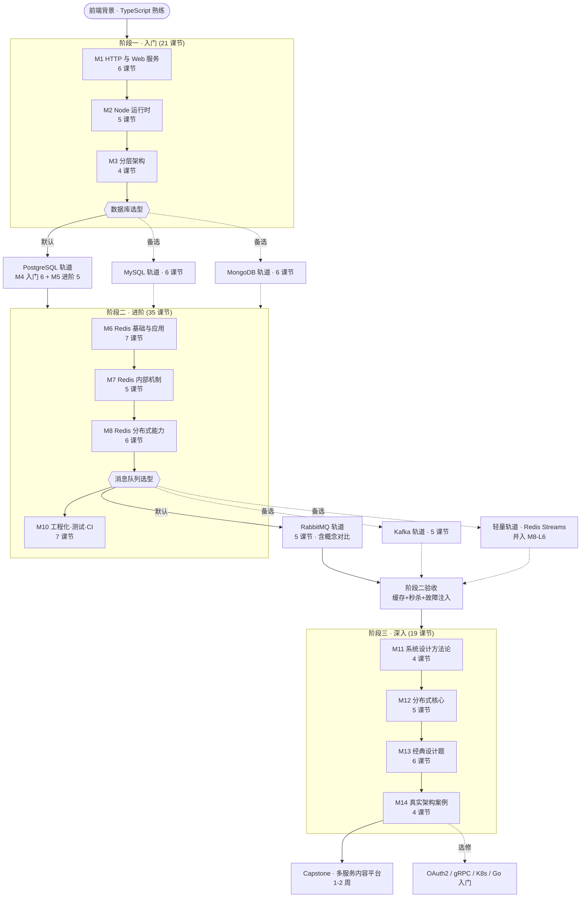

# 后端学习 Roadmap（导航图）

`curriculum.md` 是默认路径（PostgreSQL + Redis + RabbitMQ/Kafka + TypeScript）。本图是全局导航：菱形 = 选型点，虚线 = 备选轨道。用户要"看路线/换技术选型/问学什么数据库"时读本文件，并把选型记入 PROGRESS.md 的"选型"节。

---

## 选型点展开

### 选型①：数据库（阶段一末，二选一即可，建议默认）

| 轨道 | 课节 | 适合 |
|---|---|---|
| **PostgreSQL（默认）** | M4-L1..L6 + M5-L1..L5（11 课节） | 默认。事务/索引概念最全，面试主战场 |
| **MySQL 轨道**（替代 M4+M5） | 1. InnoDB 架构与 MVCC　2. 聚簇索引/回表/覆盖索引　3. 事务与锁：RC/RR、间隙锁、死锁案例　4. explain 与查询优化　5. 主从复制与读写分离　6. Node mysql2 驱动重写用户系统 | 目标岗位 Java 系公司 |
| **MongoDB 轨道**（替代 M4+M5） | 1. 文档模型与 BSON、何时该选 Mongo　2. CRUD 与聚合管道　3. 索引与慢查询　4. 事务与一致性边界　5. 副本集与分片　6. Node driver 重写用户系统 | 目标业务以非结构化数据为主 |

> 换轨不换骨架：三条轨道的课节一一对应（模型→查询→索引→事务→高可用→Node 实战），进度按同编号互认。
> 无论选哪条，M6-M8（Redis）不依赖数据库选型，照常推进。

### 选型②：消息队列（阶段二中段）

| 轨道 | 课节 | 适合 |
|---|---|---|
| **RabbitMQ（默认）** | 1. 同步 vs 异步解耦　2. exchange 类型与路由、确认机制　3. at-least-once + 幂等消费　4. 重试与死信　5. 订单-库存-通知三服务实战 | 中小规模、路由复杂的企业场景 |
| **Kafka 轨道**（替代 M9） | 1. 为什么日志型队列不同　2. topic/partition/消费者组与 offset　3. 副本与 ISR、producer acks　4. 重复投递与幂等、exactly-once 的代价　5. 流处理实战（订单事件流） | 高吞吐、事件溯源、流处理场景 |
| **轻量轨道** | 不单独开轨道：Redis Streams 并入 M8-L6（延迟队列/任务队列二选一） | 只想覆盖需求，不深究 MQ |

### 选型③：语言（贯穿，默认 TS）

- **TypeScript/Node**：全程默认，所有代码实验用它
- **Go 入门**（选修，插 M14 后，~8 课节）：后端市场第二语言；语法小、并发模型（goroutine/channel）是理解 Go 系架构的钥匙

## 使用方式

- `/roadmap`：显示本图当前位置与三条选型轨道
- 选型决定记入 PROGRESS.md「选型」节；换轨后课程按对应编号继续
